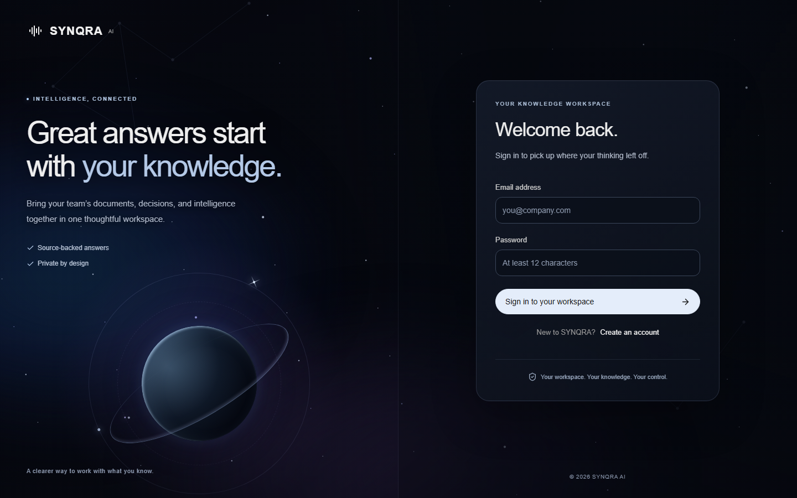
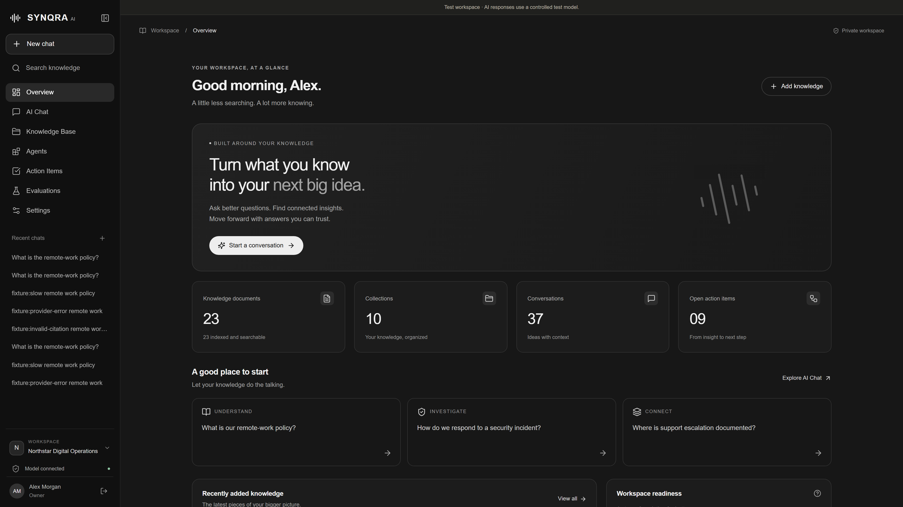
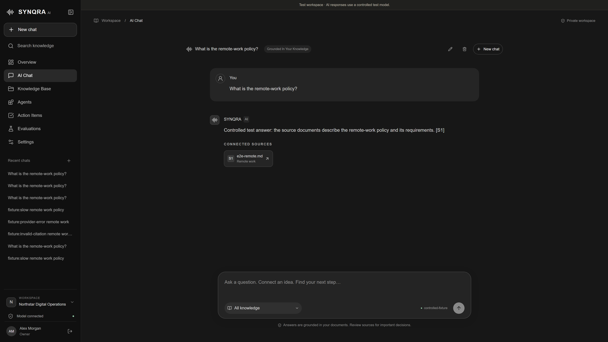
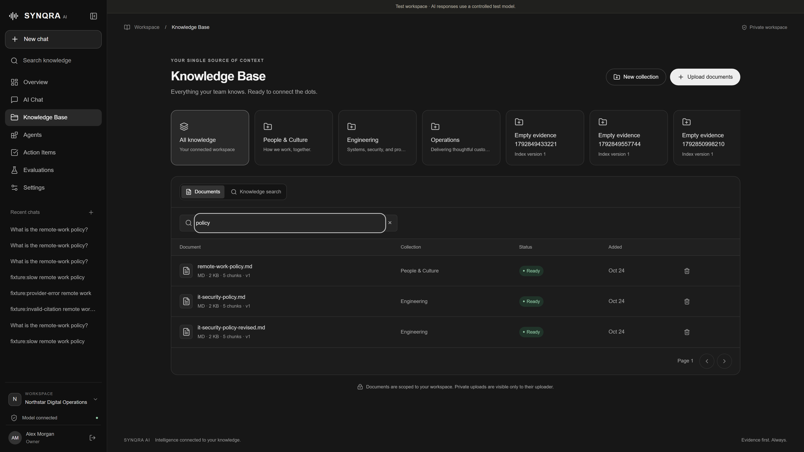
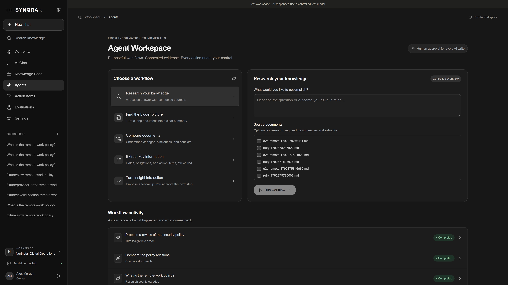
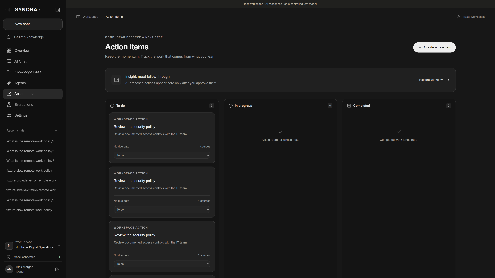
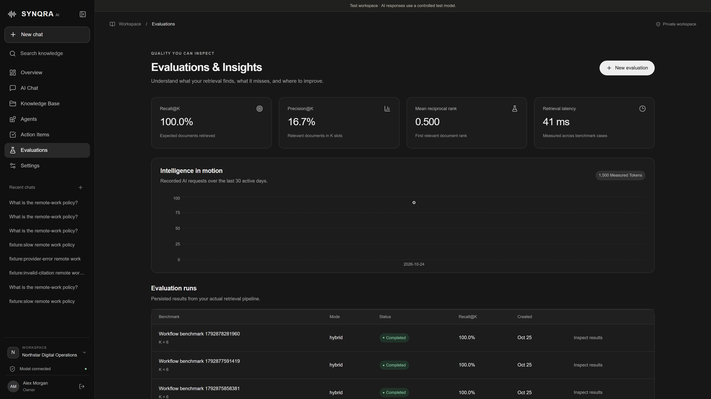
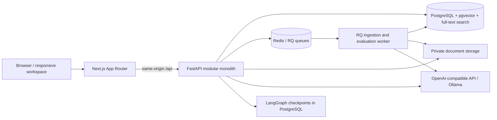
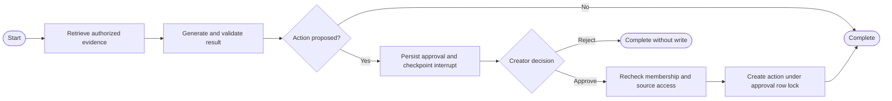

<div align="center">

# SYNQRA AI

### Intelligence connected to your knowledge.

An evidence-grounded workspace for searching documents, asking better questions,
and turning insights into human-approved actions.

[](https://github.com/charlesc004/synqra-ai/actions/workflows/ci.yml)


[Gallery](#product-gallery) · [Quick start](#quick-start) · [Architecture](#architecture) · [How RAG works](#how-rag-works) · [Agent workflows](#agent-workflows) · [Testing](#testing-and-verification) · [Documentation](#documentation)

</div>



**SYNQRA AI brings document ingestion, hybrid retrieval, streaming answers, structured
workflows and approval controls into one responsive workspace.** The product connects
to operator-configured OpenAI-compatible or Ollama models. Model credentials stay on
the server; missing configuration and provider failures are displayed explicitly.

The application is implemented and locally tested. Live-model answer quality,
production deployment and high-load behavior have not been validated. The screenshots
use fictional data from the isolated test environment; its model responses come from
an explicitly labeled deterministic HTTP fixture.

## What you can do

| Area | Capabilities |
|---|---|
| Knowledge library | Upload PDF, DOCX, TXT and Markdown; organize collections; track parsing/indexing; retry and reindex; preview sources |
| AI chat | Ask questions against authorized knowledge; stream answers with citations; inspect excerpts; retain, rename and delete conversations |
| Agent workspace | Research, summarize, compare, extract structured information and propose follow-up actions through bounded workflows |
| Human approvals | Review the exact proposed write; approve or reject; resume durable graph state; prevent duplicate action creation |
| Action items | Track proposed and approved follow-ups, assignees, status and due dates |
| Retrieval evaluation | Run document-level Precision@K, Recall@K, MRR and latency benchmarks against the shared retriever |
| Workspace administration | Manage memberships and roles, inspect model status, view measured usage and audit events, change account credentials |
| Responsive interface | Dark navigation, mobile drawer, keyboard focus management, reduced-motion support and a galaxy-inspired authentication screen |

## Product gallery

Explore the six core areas of SYNQRA AI. Select any preview to open the original
**3840 x 2160 PNG**. These screenshots show the running application with fictional
Northstar data; the visible banner identifies the controlled test model.

<table>
  <tr>
    <td width="50%" valign="top">
      <h3>01 &middot; Workspace overview</h3>
      <a href="docs/assets/screenshots/01-dashboard.png"></a>
      <p>A central view of indexed knowledge, collections, conversations and open actions, with shortcuts into the workspace.</p>
    </td>
    <td width="50%" valign="top">
      <h3>02 &middot; AI chat and citations</h3>
      <a href="docs/assets/screenshots/02-ai-chat-and-citations.png"></a>
      <p>Persistent conversations pair grounded answers with connected source cards and a scoped message composer.</p>
    </td>
  </tr>
  <tr>
    <td width="50%" valign="top">
      <h3>03 &middot; Knowledge base</h3>
      <a href="docs/assets/screenshots/03-knowledge-base.png"></a>
      <p>Organize collections, find documents, inspect indexing status and manage the evidence available to your workspace.</p>
    </td>
    <td width="50%" valign="top">
      <h3>04 &middot; Agent workflows</h3>
      <a href="docs/assets/screenshots/04-agent-workflows.png"></a>
      <p>Research, summarize, compare, extract and propose actions through explicit workflows with source selection and human approval for writes.</p>
    </td>
  </tr>
  <tr>
    <td width="50%" valign="top">
      <h3>05 &middot; Action items</h3>
      <a href="docs/assets/screenshots/05-action-items.png"></a>
      <p>Follow approved insights through to-do, in-progress and completed states, with source references and due-date information.</p>
    </td>
    <td width="50%" valign="top">
      <h3>06 &middot; Evaluations and usage</h3>
      <a href="docs/assets/screenshots/06-evaluations-and-usage.png"></a>
      <p>Inspect retrieval quality, latency, recorded AI activity and persisted benchmark results from the shared retrieval pipeline.</p>
    </td>
  </tr>
</table>

## Architecture

SYNQRA is a **modular monolith with a separate background worker**. Next.js serves the
interface and forwards same-origin API requests. FastAPI owns authentication, access
control, retrieval and workflow execution. PostgreSQL holds durable application data
and LangGraph checkpoints; Redis handles jobs and shared rate counters.



| Layer | Main technologies | Responsibility |
|---|---|---|
| Web | Next.js 16, React 19, TypeScript | Routes, workspace shell, forms and streaming UI |
| UI/data | Tailwind, Radix, TanStack Query, React Hook Form, Zod, Recharts | Shared components, server state, validation and measured usage charts |
| API | FastAPI, Pydantic, SQLAlchemy, Psycopg, Alembic | Validated APIs, persistence, migrations and authorization |
| Retrieval | pgvector, PostgreSQL full-text search, tiktoken | Vector/keyword candidates, rank fusion and token budgets |
| Workflows | LangGraph, LangChain provider integrations | Bounded steps, structured outputs and persistent approval interrupts |
| Background jobs | Redis and RQ | Ingestion, embeddings, retries, reindexing and evaluation jobs |
| Verification | pytest, Vitest, Playwright, axe, Ruff, mypy, ESLint | Unit, integration, browser, accessibility and static checks |
| Runtime | Docker Compose | Database, queue, migrations, API, worker and web services |

### Data and isolation

Users join workspaces through role-bearing memberships. Collections pin an embedding
identity and index version. Documents retain ownership, visibility, content identity,
status and a private storage key. Chunks retain text, provenance, embeddings and
full-text search data.

Conversations are scoped to their owner and workspace. Retrieval applies workspace,
document visibility, readiness, embedding identity and index-version filters before
returning evidence. Stored evaluation snapshots recheck current source access.
Relational approval records and actions remain authoritative for writes; checkpoint
state alone cannot authorize an operation.

## How RAG works

### 1. Ingest and index

```text
Upload -> validate -> private storage -> queue -> extract -> chunk
       -> embed -> validate vectors -> atomic index replacement -> Ready
```

1. The API validates upload size, supported extensions and basic file signatures.
2. A generated storage key keeps original filenames out of storage-path decisions.
3. The worker extracts PDF pages, DOCX paragraphs/headings or UTF-8 text.
4. Chunking preserves page/section provenance and targets configurable token windows.
5. The configured embedding provider returns vectors. Counts, dimensions and finite,
   nonzero values are validated before persistence.
6. Chunk/vector replacement commits transactionally. Deleted documents cannot be
   recreated by a racing indexing job.
7. Scheduled retries remain visible as `retrying`; terminal failures expose manual
   retry controls. Documents without an embedding provider await configuration.

Defaults are 500-token chunks with 80-token overlap. `cl100k_base` provides token
accounting; it is an approximation for models using other tokenizers. OCR and DOCX
table extraction are not implemented.

### 2. Retrieve authorized evidence

- **Semantic branch:** pgvector cosine-distance candidates, with HNSW index support.
- **Keyword branch:** PostgreSQL `websearch_to_tsquery`, `tsvector` and `ts_rank_cd`,
  backed by a GIN index.
- **Fusion:** Reciprocal Rank Fusion adds `1 / (60 + rank)` per branch rather than
  combining incompatible raw semantic and keyword scores.
- **Optional reranking:** deterministic lexical overlap, not a learned cross-encoder.
- **Filters:** workspace, visibility, document state, collection/document selection,
  embedding identity and index version.

Knowledge search, chat and graph tools use the same retriever. Reindexing increments
an index version and excludes incompatible chunks while rebuilding. It currently
involves indexing downtime rather than a blue/green index switch.

### 3. Generate and validate

The backend deduplicates and budgets source excerpts, assigns labels such as `S1`,
and treats retrieved text as untrusted prompt data. The provider streams tokens;
an incremental citation guard rejects references outside the retrieved source set.
A sourced answer must finish with valid citations before it is marked complete.

If retrieval returns no evidence, the system returns an explicit limitation message
without calling the model. Source cards open authenticated document previews and the
cited excerpt. Valid citation identifiers do not prove factual entailment; source
inspection and generation-quality evaluation remain necessary.

### Streaming contract

Chat uses a fetch-based SSE stream at
`POST /api/v1/conversations/{id}/stream`.

| Event | Purpose |
|---|---|
| `message_started` | Identify the generation attempt |
| `retrieval_completed` | Report the number of retrieved sources |
| `token_delta` | Append a validated text delta |
| `generation_completed` | Finalize the answer and citations |
| `generation_failed` | Surface a failed or interrupted attempt |

The client handles split UTF-8 bytes, CRLF/frame boundaries, aborts and missing terminal
events. Answers remain provisional until completion. A stable generation UUID prevents
blindly appending the same attempt twice.

## Agent workflows

| Workflow | Behavior |
|---|---|
| Research | Retrieve evidence and produce a cited answer; optionally prepare a search through one bounded model tool call |
| Summarize | Summarize bounded excerpts from selected documents |
| Compare | Compare at least two selected documents using validated structured output |
| Extract | Return structured information with missing values left null/empty |
| Propose action | Generate a proposed follow-up and pause for an explicit human decision |

The graph follows an explicit workflow enum rather than an unrestricted autonomous
planner. It has a recursion limit of eight and a 180-second execution timeout.



The tool registry contains `search_knowledge`, `get_document_excerpt`,
`compare_documents`, `list_action_items` and `create_action_item`. It exposes no shell,
arbitrary SQL, unrestricted HTTP, filesystem browsing or secret-reading tool.

For writes, the interface shows the exact proposed parameters. The backend records
the authenticated decision, rechecks current permissions and uses row locking plus a
unique approval/action constraint to prevent duplicate actions. Rejection creates no
action. Step events record workflow/tool names, status and timing, not private reasoning.

## Quick start

### Prerequisites

- Docker Engine/Desktop with Compose v2.
- A configured OpenAI-compatible or Ollama chat model and embedding model for AI
  generation/indexing. You can start the interface before configuring a provider.
- Node.js 22+ and Python 3.12+ only if developing outside Docker.

### Start the application

```sh
git clone https://github.com/charlesc004/synqra-ai.git
cd synqra-ai
cp .env.example .env
```

On PowerShell, replace `cp` with `Copy-Item .env.example .env` if preferred.
Edit `.env`: set your database password, model configuration and an optional
`SEED_PASSWORD` of at least 12 characters if you want the fictional sample workspace.

```sh
docker compose up --build -d
```

| Service | Local URL |
|---|---|
| Workspace | http://localhost:3000 |
| Interactive API documentation | http://localhost:8000/docs |
| Process liveness | http://localhost:8000/api/v1/health |
| Dependency readiness | http://localhost:8000/api/v1/ready |

The one-shot migration service initializes business tables and PostgreSQL checkpoints
before dependent services start. Exposed service ports bind to localhost.

Register a new account for a personal workspace. To load the fictional Northstar demo:

```sh
docker compose exec api python apps/api/scripts/seed.py
```

Seeding creates three collections, 12 documents and two sample action items. The
accounts are `alex@northstar.example` (owner), `jamie@northstar.example` (member) and
`casey@northstar.example` (viewer), all using your configured `SEED_PASSWORD`. Seeding is
idempotent and does not reset existing passwords. Demo documents require a working
embedding configuration before they become searchable.

### Connect a provider

<details open>
<summary><strong>OpenAI or an operator-configured compatible endpoint</strong></summary>

Set these server-only variables in `.env`:

```dotenv
AI_PROVIDER=openai
CHAT_MODEL=<model available to your account>
OPENAI_API_KEY=<your server-side API key>
EMBEDDING_PROVIDER=openai
EMBEDDING_MODEL=<your embedding model>
EMBEDDING_DIMENSION=<the model's exact output dimension>
MODEL_SUPPORTS_STRUCTURED=true
```

Enable `MODEL_SUPPORTS_STRUCTURED` only after verifying JSON-schema support. Enable
`MODEL_SUPPORTS_TOOLS` only for a model with verified tool-call support. Model names
are configuration, not application constants. A trusted operator can set
`OPENAI_BASE_URL` for a compatible endpoint; ordinary API users cannot choose it.

</details>

<details>
<summary><strong>Ollama</strong></summary>

Install Ollama separately and pull chat and embedding models appropriate for your
hardware. Set:

```dotenv
AI_PROVIDER=ollama
CHAT_MODEL=<installed chat model>
OLLAMA_BASE_URL=http://host.docker.internal:11434
EMBEDDING_PROVIDER=ollama
EMBEDDING_MODEL=<installed embedding model>
EMBEDDING_DIMENSION=<the model's exact output dimension>
```

For host-based development, use `http://localhost:11434`. Container access depends on
the model server's listening interface and firewall. Verify context, structured-output
and tool support for the selected model; configure memory and context budgets for
its hardware requirements.

</details>

After changing provider configuration:

```sh
docker compose up -d --force-recreate api worker
```

Select the relevant collection and choose **Reindex collection**. New failed uploads
can use **Retry**. Changing provider/model identity requires reindexing; changing
embedding dimensions also requires an explicit schema migration and HNSW rebuild.
The current configured dimension must be between 1 and 2000. The application does
not perform destructive schema changes automatically.

### Configuration reference

| Setting | Purpose |
|---|---|
| `DATABASE_URL`, `POSTGRES_PASSWORD` | Database connection; match the password when running the API on the host |
| `REDIS_URL` | Shared job queue and rate counters |
| `APP_ORIGIN`, `COOKIE_SECURE` | Trusted browser origin and secure-cookie deployment behavior |
| `STORAGE_PATH`, `MAX_UPLOAD_MB` | Private file storage and upload bounds |
| `AI_PROVIDER`, `CHAT_MODEL` | Generation provider and model |
| `EMBEDDING_PROVIDER`, `EMBEDDING_MODEL`, `EMBEDDING_DIMENSION` | Index identity and vector shape |
| `MODEL_SUPPORTS_STRUCTURED`, `MODEL_SUPPORTS_TOOLS` | Explicitly declared, operator-verified capabilities |
| `CHUNK_TOKENS`, `CHUNK_OVERLAP` | Ingestion windows |
| `RETRIEVAL_K`, `SEMANTIC_CANDIDATES`, `KEYWORD_CANDIDATES`, `RERANK` | Retrieval and ranking controls |
| `CONTEXT_TOKENS`, `MODEL_CONTEXT_TOKENS`, `MAX_OUTPUT_TOKENS` | Evidence, context and output budgets |
| `TEST_MODE` | Explicit test labeling; leave false for ordinary use |

See [`.env.example`](.env.example) for all defaults. Provider-listing connectivity in
Settings is not proof that generation and embedding requests have succeeded. Actual
requests validate provider errors, structured output and vector shape.

## Local development

Start PostgreSQL/pgvector and Redis, copy/edit `.env`, then use a virtual environment.
The following example uses a POSIX shell:

```sh
docker compose up -d postgres redis
python -m venv .venv
source .venv/bin/activate
python -m pip install -e 'apps/api[dev]'
alembic -c apps/api/alembic.ini upgrade head
python apps/api/scripts/init_checkpoints.py
python apps/api/scripts/seed.py        # optional; requires SEED_PASSWORD
uvicorn app.main:app --reload --port 8000
```

In separate terminals with the environment activated:

```sh
python -m app.worker
```

```sh
npm ci
npm run dev
```

On Windows, activate `.venv/Scripts/Activate.ps1` or invoke `.venv/Scripts/python`
directly. RQ's fork worker is intended for Linux: run it in Docker or WSL on Windows.
The frontend proxies to `http://localhost:8000` by default; `API_INTERNAL_URL` changes
that trusted upstream. Docker rewrites are configured at build time.

Development and production use separate `.next-dev` and `.next` directories. Webpack
is selected explicitly. The API image preloads the public tiktoken vocabulary; host
setups may download it on first use. `apps/api/requirements.lock` records a historical
Windows/Python 3.14 environment, not a verified Linux deployment lock.

## API surface

All application endpoints use the `/api/v1` prefix. See the running OpenAPI UI for
request schemas, required workspace headers and authentication details.

| Resource | Representative routes |
|---|---|
| Authentication | `/auth/register`, `/auth/login`, `/auth/me` |
| Workspaces and members | `/workspaces`, `/workspaces/{id}/members` |
| Collections | `/collections`, `/collections/{id}/reindex` |
| Documents | `/documents`, `/documents/{id}/preview`, `/documents/{id}/retry` |
| Retrieval | `/knowledge/search` |
| Chat | `/conversations`, `/conversations/{id}/stream` |
| Agents | `/agents/runs`, `/agents/runs/{id}/approve`, `/agents/runs/{id}/reject` |
| Actions | `/actions` |
| Evaluations | `/evaluations`, `/evaluations/dataset`, `/evaluations/runs` |
| Operations | `/providers/status`, `/usage/summary`, `/audit`, `/health`, `/ready` |

## Security and operational behavior

- Password hashing, opaque hashed sessions, session rotation and password-change
  revocation protect account access. Cookie authentication uses CSRF and Origin checks.
- Backend authorization applies workspace membership, role and document visibility;
  switching frontend workspaces discards page-local unsaved state.
- Private uploads are stored outside public web assets, with bounded parsing and
  generated storage keys. Deletion tombstones prevent indexing races from reviving data.
- Production CSP uses random per-request nonces and blocks eval/unapproved inline
  scripts. Zod runs without JIT. Required React/Radix style attributes remain allowed.
- Readiness checks PostgreSQL and Redis concurrently with a three-second deadline.
  Two shared probe threads prevent unbounded probe backlogs. Liveness remains separate.
- Python/Node base images and the patched pip artifact are pinned. Actual application
  dependency hash locking remains separate work.

Read [architecture/security boundaries](docs/architecture.md) and the
[hardening report](docs/security-hardening.md) before planning a deployment. Production
requires HTTPS, secure cookies, secrets management, backups, network restrictions,
proxy request limits and capacity/resilience validation appropriate to the deployment.

## Testing and verification

The latest full **local** verification on 25 October 2026 passed **84 tests**:

| Suite | Result |
|---|---:|
| Python unit, HTTP, PostgreSQL, authorization, agent and readiness tests | 57 passed |
| Vitest API-client and SSE tests | 12 passed |
| Production Chromium workflows, including adversarial CSP | 15 passed |

Additional checks covered 52 interface states across 1440px, 768px, 390px and 320px;
zero automatic accessibility violations, unexpected CSP/JavaScript errors or page
overflow were reported. Real PostgreSQL, Redis and combined outage checks returned
503 readiness in approximately three seconds and recovered to 200. Axe manual-review
entries remain in 33 states; this is not full WCAG certification.

### Fast checks

```sh
npm ci
npm run check:english
npm run typecheck
npm run lint
npm run test:frontend
python -m ruff check apps/api
python -m mypy apps/api/app --config-file apps/api/pyproject.toml
```

All first-party source, documentation, fixtures and interface copy are maintained in
English. The language check also runs in CI; see [`AGENTS.md`](AGENTS.md).

### Full isolated system suite

```sh
docker compose -f tests/compose.yml up --build -d
docker compose -f tests/compose.yml exec api python apps/api/scripts/seed.py
docker compose -f tests/compose.yml build checks
docker compose -f tests/compose.yml run --rm checks
npx playwright install --with-deps chromium
E2E_BASE_URL=http://localhost:3010 npm run test:e2e
```

On PowerShell, set `$env:E2E_BASE_URL='http://localhost:3010'` before running the browser
suite. The isolated web/API use ports **3010/8010** and separate database/storage
volumes. Browser security tests require the production frontend used by this stack.

The model fixture is deterministic HTTP, not live inference. PostgreSQL, pgvector,
Redis, the RQ worker, authentication and graph checkpoints are real. Do not run the
system suite against production. The separately runnable
`python3 tests/readiness_outages.py` intentionally interrupts test dependencies;
run it outside other tests and follow [its documented scope](docs/security-hardening.md).

Direct backend integration tests require a disposable `TEST_DATABASE_URL` with
extension-creation privileges. Without it, PostgreSQL-dependent tests skip. Test
results must distinguish those skips from full integration coverage.

GitHub Actions defines backend, frontend and production browser jobs. The badge above
reflects hosted workflow status; local results are documented separately in the
[test report](docs/testing-report.md) and [comprehensive audit](docs/comprehensive-audit.md).
Generated test artifacts stay out of Git.

## Project layout

```text
synqra-ai/
  apps/
    web/
      src/app/             Authentication and workspace routes
      src/components/      Shared shell, UI primitives and data displays
      src/features/        Auth, chat, knowledge, agents, actions, evaluations, settings
      src/lib/             HTTP client, SSE parser, queries and shared types
      src/providers/       Authenticated workspace and query context
      src/styles/          Responsive theme and authentication motion
      src/proxy.ts         Per-request CSP and nonce generation
      tests/               Vitest client and streaming tests
    api/
      app/core/            Configuration, database, security and health probes
      app/modules/         Feature routers and application services
      app/ai/              Providers, ingestion, retrieval, RAG, tools and graph
      app/jobs/            Shared background-job submission
      app/shared/          Access control, pagination and audit helpers
      app/models.py        Relational, vector and full-text schema
      alembic/             Database migrations
      scripts/             Fictional seed and checkpoint initialization
      tests/               Unit and PostgreSQL integration tests
  datasets/                Fictional corpus and retrieval benchmark
  tests/                   Playwright workflows, HTTP fixture and operational checks
  docs/                    Architecture, audits, screenshots and implementation notes
  .github/workflows/       Backend, frontend and browser CI
  docker-compose.yml       Local application runtime
```

## Current boundaries and roadmap

The implemented foundation is intentionally explicit about its limits:

- Live OpenAI/Ollama compatibility and semantic answer quality need validation against
  the intended models and corpus. Citation checks validate source identity, not entailment.
- Large-document summaries/comparisons use bounded excerpts; OCR and DOCX table
  extraction remain future work.
- Agent workflows are bounded. Continuous agent-event SSE, persistent agent
  cancellation and administrator approval delegation are not implemented.
- Reindexing has downtime; automatic vector-dimension migrations and blue/green index
  switching are absent.
- Retrieval benchmarks do not yet include generation-faithfulness scoring or complete
  corpus/model revision snapshots.
- Load testing, backup restoration, abrupt in-flight crashes, automatic scheduler
  failover, screen readers, Firefox/WebKit and physical-device testing need further work.
- A complete Linux dependency hash lock, parser memory isolation/content scanning and
  advanced account/administration controls remain release work.

See the [implementation report](docs/implementation-report.md) for the detailed backlog.

## Documentation

| Document | What it covers |
|---|---|
| [Architecture](docs/architecture.md) | Data model, trust boundaries and deployment assumptions |
| [RAG pipeline](docs/rag-pipeline.md) | Ingestion, rank fusion, token budgets, citations and SSE |
| [Agent workflow](docs/agent-workflow.md) | Tool boundaries, checkpoints and approval transactions |
| [Evaluation](docs/evaluation.md) | Precision@K, Recall@K, MRR, latency and reproducibility |
| [Testing report](docs/testing-report.md) | Verified suites and reproduction commands |
| [Comprehensive audit](docs/comprehensive-audit.md) | Findings, fixes, accessibility and duplication review |
| [Security hardening](docs/security-hardening.md) | Patched pip, nonce CSP, readiness and real outages |
| [Theme design](docs/theme-redesign.md) | Responsive dark interface and navigation decisions |
| [Implementation status](docs/implementation-report.md) | Original implementation snapshot and remaining requirements |
| [Publishing guide](docs/github-publishing.md) | Git hygiene and subsequent publishing commands |

## Contributing

Open an issue to discuss substantial changes. Keep source and documentation in English,
reuse the shared access/retrieval/UI services, add regression coverage for behavior changes,
and run the relevant checks before opening a pull request. Keep real credentials,
uploaded files and generated reports out of commits. Report sensitive vulnerabilities
privately through GitHub's security reporting channel when it is available.

## License

A project-wide license has not been specified.
